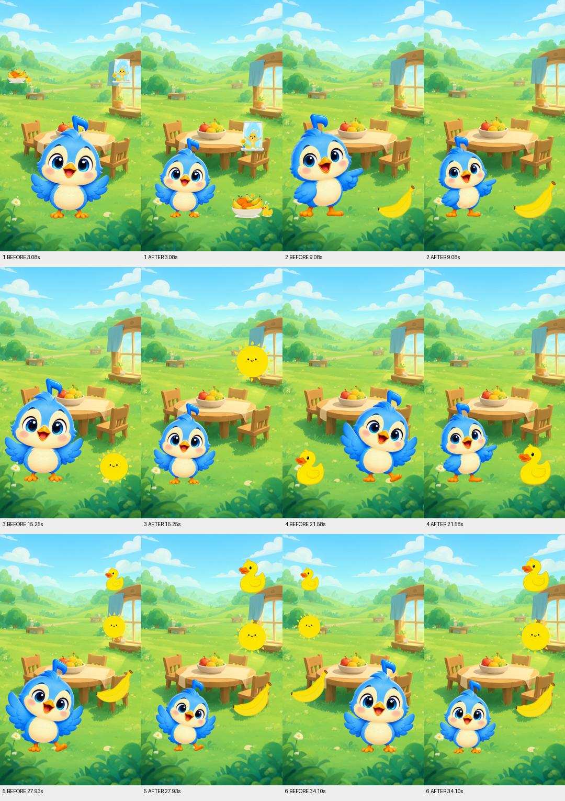
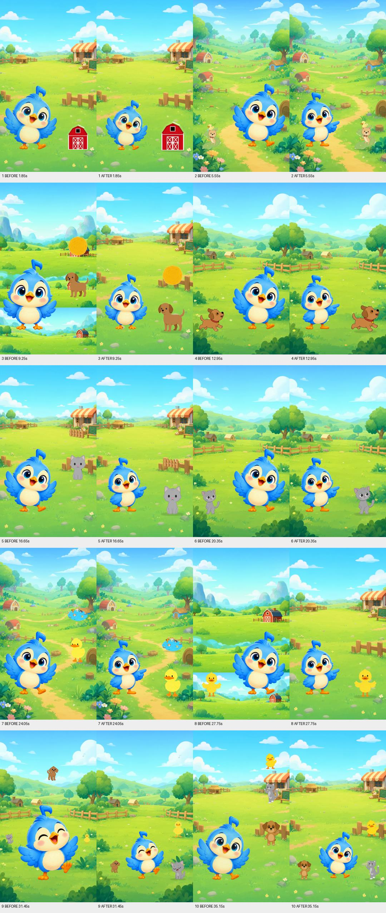
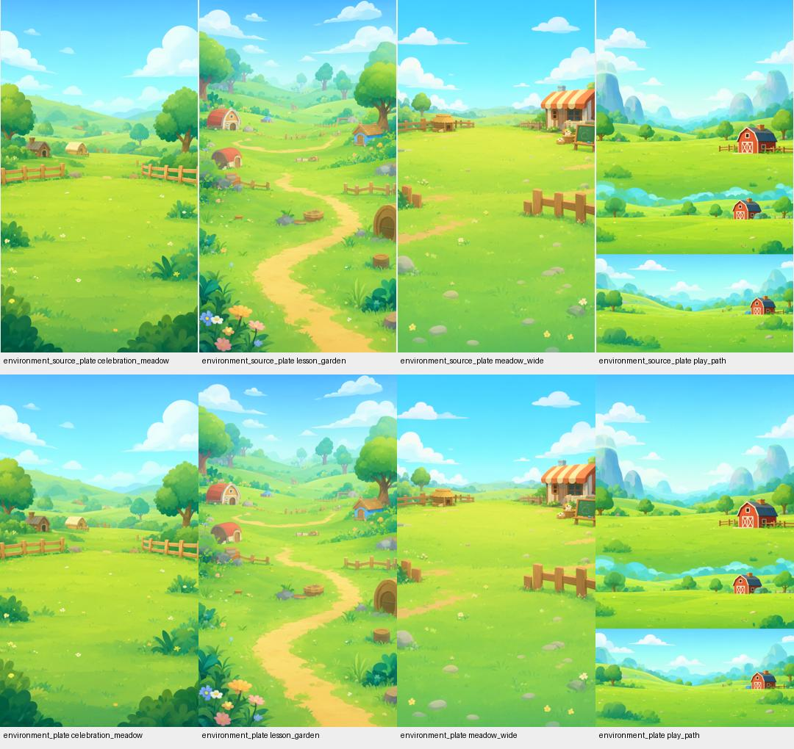

# Visual Quality V1 review

This opt-in V3 preview strategy corrects unsupported animal placement, enlarges teaching objects and adds quieter focal motion. It preserves the accepted production renderer and all retained sources. Both real previews passed full-resolution media QA; visual improvement is demonstrated in the comparisons below. It does not resolve every art or framing concern.

Baseline: `f78dcdf1ebb19865552748023b8c9a91bf4829ba`, the draft, unmerged PR #44 feature branch. Review branch: `codex/visual-quality-v1`; stacked PR targets `refactor/creative-production-v3`. No merge, live image request, music request or YouTube operation was performed.

## Original frame audit and confirmed causes

Before implementation, the selected manifests and MP4 hashes were verified. Native 1080×1920 frames were extracted at every scene's start, midpoint and final frame, plus Animals at 8, 9, 10 and 31 seconds. Source plates, retained composition, motion and animation records were inspected. The local handoff contains the original audit, complete records and frames.

| Priority | Finding | Cause and classification | Correction / limit |
|---|---|---|---|
| 1 | Horizontal scenery bands around Animals 8–10s | Source `f58a9740-e910-4aab-842b-2b854d948b29` is already three stacked landscapes; normalized plate `69e29e0b-807a-4175-ad8d-1fbe961f4170` retains them. `ProductionRenderer._render` resizes one opaque plate, then the composer transforms the complete scene. Source-art defect. | Explicit preview-only `play_path=meadow_wide` selects an existing coherent farm plate. Actual plate dependency is pinned in each affected scene. No blur, source edit or replacement environment-set record. |
| 2 | Dog suspended near 31s | `stage_composition` performance puts the primary at `(0.50,0.27)` and others in side displays regardless of tangible metadata. Weak layout default. | Three grounded animals flank centered Tovi, with a smaller rear animal. Contact shadows and ground-preserving pulses provide visual support. |
| 3 | Yellow sun on grass | Retained V2 compilation defaults every scene element to `grounded=True`; single pointing target layout follows it. Weak semantic default. | Read conceptual labels and explicit floating/card intent from admitted inputs at render time. Sun floats; intentionally floating recap remains allowed. Compiled plans are unchanged. |
| 4 | Small subjects, competing character scale | Props occupy widths 0.30, 0.19 or 0.12; alpha padding further reduces visible art. Character lane permits 0.54/0.60. Weak balance defaults. | Larger focal subjects, quieter Tovi lane and distinct solo, surface-pair, group and display layouts. Sparse occupancy remains an advisory concern. |
| 5 | Different animal drawing styles / depth | Different admitted object descriptions produce separate asset keys and provider art. Normalization preserves those styles. Source-art inconsistency. | Future textual prompts specify soft 2D shading, tonal contours, warm light, consistent perspective and natural animal anatomy. Existing assets are reused; new prompt quality is not visually validated. |
| 6 | Repeated pops, camera motion and unrelated waves | `plan_motion` applies similar entrances/reactions and idle hello/neutral poses. Weak motion defaults. | Staggered surface accents, one main reaction and hold; quiet scenes keep a static camera, active camera settles early; same-state transitions retain the prior camera endpoint. |
| 7 | Grasping, squeezing and articulated actions | No approved grasp or articulated limb rig. Capability limitation. | Use approved presenting/pointing/neutral/greeting poses. No fabricated hand contact. |
| 8 | Yellow's repeated setting | One retained kitchen-table setting binds all six scenes to the same role. Editorial choice. | Retain the model's setting and subject vocabulary. Staging changes do not rewrite the story. |

## Visible comparison

Adjacent pairs are BEFORE then AFTER at each scene's midpoint. The local handoff also includes start/end sheets and native frames.



Yellow: banana and duck are larger relative to Tovi; sun is a larger conceptual display above ground; floating recap is deliberate and retained through farewell. Pointing better directs attention toward the subject. Repeated setting and three dead-space advisories remain.



Animals: scenes 3 and 8 use continuous scenery, confirmed at native resolution. Near 31s, the dog rests beside Tovi instead of hovering above him. Solo animals are more readable; group farewell uses an approved greeting in place rather than crossing a friend. Original animal styles and some depth ambiguity remain.

The source plate comparisons establish the scenery defect existed before composition:



## Focused implementation

| Files | Reason |
|---|---|
| `render/composition.py`, `render/story.py` | Explicit `tovitunes_visual_quality_v1`, optional surface position, deterministic interpretation of admitted display intent, varied focal arrangements and retained-layout continuity. Legacy staging remains available. |
| `render/motion.py` | Opt-in surface-safe pulses and focal holds; stable camera endpoint for inherited/modified scenes. Add exact contact-loss rejection for stationary surface-supported V1 props. Existing boundaries, overlap, envelope and three-major-motion checks remain. |
| `render/character.py` | Optional common integer pose height after fitting narrower lanes prevents one-pixel scale jumps. Historical behavior remains the default. |
| `render/composer.py` | Opt-in soft contact shadows under grounded objects. |
| `render/production.py`, `render/models.py` | Preview admission, V3 requirement, separate `_vq1` slots/exports and exact dependency-sensitive reuse. Role overrides are explicitly preview-only and reference admitted environment roles. Identical output bytes with different dependency IDs/hashes receive separate immutable versions. |
| `render/episode_assets.py`, `render/environment_sets.py` | Concise compatible art direction; natural animal anatomy permitted; future environments request a single continuous landscape without stacked panels. Existing assets/receipts are reused before generation; uncertain requests remain protected. Prompt content still participates in request fingerprints. |
| `creative/prompts.py` | Soft guidelines for central focus, visual sequencing and supported interactions; no new generation schema, lyric gates or judging service. |
| `review/visual_quality_preview.py` | Provider-free runner backs up production SQLite read-only and verifies/copies retained media into a new isolated workspace, then renders under a real execution lease. |
| `tests/test_creative_production_v3.py`, `tests/test_visual_quality.py` | Three focused regression cases cover preserved completed sources, historical render admission, preview reuse, grounded animals, conceptual displays, mixed layouts, farewell continuity, camera endpoints, spatial validation and publication isolation. |

The normal production/orchestrator path continues using its accepted renderer. This review strategy requires explicit `local_preview=True`, `visual_quality=True` and `visual_story=True`. No production rollout is implied by this draft PR.

## Reproduction

Run from this branch with the existing locked render environment and `PYTHONPATH=src`. Each workspace must be new and separate from the production checkout. The source config is not copied; isolated configuration keeps automatic publication disabled.

```powershell
$env:PYTHONPATH = (Join-Path (Get-Location) 'src')
python review/visual_quality_preview.py --source-root C:/Users/Victus/Desktop/ToviTunes --workspace C:/isolated/yellow-vq1 --output C:/review/yellow --episode-key identify-yellow-in-familiar-objects-f8de3ea4-001
python review/visual_quality_preview.py --source-root C:/Users/Victus/Desktop/ToviTunes --workspace C:/isolated/animals-vq1 --output C:/review/animals --episode-key name-the-sounds-of-a-dog-cat-and-duck-f67720b4-001 --replace-role play_path=meadow_wide
```

Actual acceptance used separate `work/preview-yellow-v1` and `work/preview-animals-v1` copies. Iterations retained immutable versions within those copies. Original successful/uncertain provider receipts were never resubmitted. The final manifests identify the unchanged admitted storyboard, AudioClock, audio master, character pack, source props and actual background plate dependencies.

## Media identity and preservation

| Episode | Accepted MP4 SHA-256 | New preview SHA-256 |
|---|---|---|
| Yellow | `54a78e6e61706d79c69e57bc02e46e0d25977aae67d9b611fa57356753ab53fb` | `db3ace45492399e0d0f86c993e06c3656dec6451ea6e1c00c9b661ce63fa2ca6` |
| Animals | `b26e0d494b5c6c605e99a0757e199d30558ee9d4cfbfe0ea435b2de416bcdc3a` | `e2bb686fe8e810e1efe41c92c03c1a54903e3f06ecbb22e1b4314ceb4c786fc9` |

Accepted selected video IDs: Yellow `db807fff-9779-45d7-8232-d77d504b8314`; Animals `f7f2b46f-47e7-47e5-9017-9b85b46faf8b`.

New preview IDs: Yellow `1d2a55a5-bfe5-4a7c-885c-03e5881e9bff`, manifest `d53705c5-d37b-4df4-80b0-b580d7b1355b`; Animals `79ba6368-f25c-42b8-9816-968336525f01`, manifest `9ac96b2d-adcb-4eea-99ec-79d29b5367da`.

Both previews: 1080×1920, 30 fps, 37 seconds, H.264/yuv420p, AAC stereo 48 kHz; full decoding and all final media QA checks passed. Scene coverage: Yellow 6, Animals 10; no gaps/overlaps. Maximum simultaneous major motion remains 3. Both report zero provider calls and publication blocked.

The retained audio master IDs and bytes match exactly:

- Yellow `bc915bc1-c1fa-4405-a376-c16deef78d84`, SHA `2caace3c7033c8643167167772cf2ae222faa31e57c401b4f099eff2a57173cc`.
- Animals `29330040-8a2f-47e9-abb4-fe399d44e64d`, SHA `9a0f2a4affb6fed7a66db2ab8e7749e8ac8056e12443b41a9eb79c9b3b41a19e`.

Before/after snapshots compare all 52 production SQLite tables (3,289 rows), all 292 registered artifact files' actual hashes/sizes and the original configuration hash. They include selections, generation history, leases, source music and publication records. Verification is exact equality, not only a check of the two MP4s. Snapshot files contain evidence only; no config contents or credentials are exported.

The two original music-provider WAV outputs also match their durable receipt SHA values and the files in both isolated copies; this evidence is saved separately in `source-music-evidence.json` in the local handoff.

## Verification

- Focused motion/composition/story/render/V3/short-production suite: **223 passed**, one existing Starlette/httpx deprecation warning, 598.58s.
- Ruff (`src`, `tests`, new review runner): passed.
- Mypy: passed, 121 source files.
- Character-pack lock: valid, all 48 assets.
- Full offline suite: **1,085 passed**, one existing Starlette/httpx deprecation warning, 1067.79s (17:47). Run with the locked environment: `uv run --locked --no-sync python -m pytest -q -o faulthandler_timeout=120 --tb=short`.
- Original production snapshot: unchanged; final verification recorded in the local handoff.

## Remaining limitations

These previews demonstrate targeted placement and scenery improvements; they do not establish final editorial acceptance for all criteria.

- Sparse occupancy did not improve: Yellow advisories remain 3/6; Animals increase from 5/10 to 10/10 under the existing vertical-occupancy metric. Smaller Tovi and physically grounded subjects leave more open sky. This is an explicit framing tradeoff, not a disabled check or a claimed success.
- The retained kitchen-table setting stays repetitive. Yellow's window illustration already includes an unexpected rabbit; the fruit-bowl illustration includes extra small imagery. Larger subjects can make these source issues more apparent.
- Existing animals vary between flat and shaded styles and between poses. Future prompt changes need separately authorized live generation to evaluate their visual effect; no image-reference conditioning is assumed.
- Surface positions and shadows suggest foreground/rear depth, but the opaque backgrounds do not provide a physical support map. Table, pond and hay-bale alignment remains approximate. New artists or a support-aware renderer would be needed for stronger contact relationships.
- Ground contact measures the retained asset canvas. Some source illustrations contain faint isolated alpha pixels below their visible feet; these can leave a visible foot/shadow gap even when the admitted canvas stays supported. The dog at 31s is moved onto the foreground grass, but its source silhouette still has this limitation. No heuristic deletion of source details was applied.
- Existing partial image requests with earlier prompt content remain subject to the existing fingerprint/reconciliation guard. Changed guidance never authorizes automatic resubmission of successful or uncertain requests.
- Different admitted prop sets can still reset composition, scale or camera. Identical intended layouts and supported continuity are stabilized; arbitrary scene changes are not guaranteed seamless.
- Grasping, articulated actions and mouth animation remain unavailable. Supported poses simplify intent. No new ASR or exact lyric timing was introduced.
- The scenery substitution is an explicit Animals evaluation override. It does not silently repair arbitrary future source collages or change the original environment selection. Future coherent-environment prompt guidance is preventive, not a proven source repair.
- Quiet holds improve readability, but reduce animation variety in several Animals scenes. The three-motion budget and all admission checks remain enforced.
