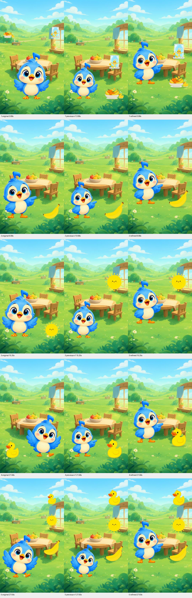
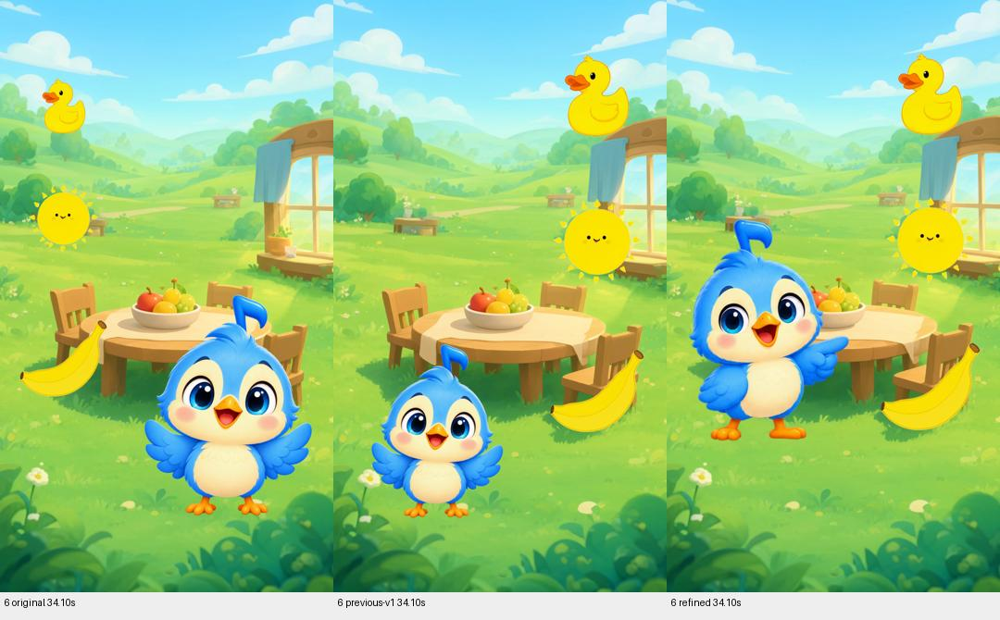
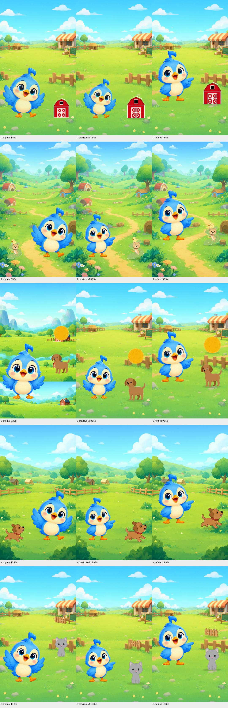
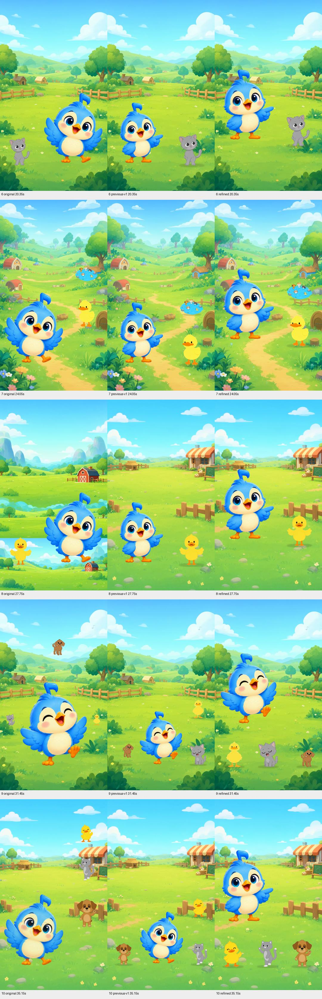

# Visual Quality V1 framing refinement

The revised retained-source videos restore Tovi's prominence, gather tangible subjects into clearer compositions and give presentations an earlier, readable reaction. This is a revision of the existing opt-in PR #45 strategy. The accepted production renderer remains the default. Both PR #45 and its base PR #44 remain draft and unmerged.

Starting point verified locally and remotely: `codex/visual-quality-v1` at `ab9f30066abc67d61e233dccc172eabaf3c44e11`, clean worktree. Base: `refactor/creative-production-v3` at `f78dcdf1ebb19865552748023b8c9a91bf4829ba`.

## Initial findings and resulting behavior

Before changing renderer code, native 1080×1920 frames were decoded at the start, midpoint and last frame of every original/V1 scene. Additional samples cover entrances, reactions, scenery boundaries and farewells. The handoff contains those frames, composition/motion/pose records and a timestamped issue inventory.

| Sequence | Root cause | Refined behavior |
|---|---|---|
| Animals 0–29.6s; Yellow 0–24.67s | Lanes of 0.39/0.42 and the widest approved pose constrain apparent height well below the nominal 0.48 height cap. Subjects sit low and far apart. | A wider safe presentation lane and higher subject group restore visual hierarchy. One height fits the entire approved pose family, preventing a later wave or singing pose from shrinking Tovi. |
| Animals 29.6–37s | Small central Tovi, small rear animal, and a padded dog source. At 31s the dog's visible feet are about 72px above its canvas anchor. | Tovi presents a foreground row of three animals. Readable feet share a support line; shadows follow those feet. The complete source artwork, including faint detail, is retained. |
| Yellow banana 6.17–12s and duck 18.5–24.67s | Weak character/subject balance and late, repetitive gestures. | Larger Tovi acknowledges the right-side subject earlier, then holds the presentation and resolves gently. Objects keep their readable V1 size. |
| Yellow sun 12–18.5s and recap 24.67–37s | Intentional conceptual display, but small Tovi. | Floating sun/cards remain deliberate. The recap adds a supported celebration pose; farewell greets in place instead of restarting an entrance. |
| Animals cat 14.8–22.2s | Padding overstates actual silhouette; repeated neutral/point cycles feel mechanical. | Stronger character scale, earlier pointing and a longer readable hold. Companion objects remain separated. |
| Animals scenery 7.4–11.1s and 25.9–29.6s | The original source contained stacked scenery bands; V1's explicit alternative plate fixed it. | The same retained alternative plate is preserved, review-only and dependency-pinned. No episode-specific override was added to renderer defaults. |
| Animals performance 29.6–33.3s | One singing pose lacks subject acknowledgement. | Neutral discovery → approved pointing → singing, with time to read each pose. |

## Three-way visual comparison

Columns are **original / previous V1 / refined V1**, at identical timestamps. These are decoded final-video frames. Every scene is represented; start/end sheets, native critical frames, full synchronized comparison videos and interaction clips are in the local handoff.

The review inspected the completed videos through all-scene starts/midpoints/ends, complete decoded progression at 2fps, and denser critical samples. It checked the banana/sun/duck sequence, Animals 8/9/10s, cat sequence, dog at 31s, and both farewells. Full comparison MP4s permit continuous playback with matching audio.

Tovi is visibly more prominent throughout than in the previous V1 previews. The revised group reads as a gathered lesson rather than tiny subjects distributed across a landscape. The foreground row creates a deliberate cut at 29.6s; scale remains stable. Some accepted original shots already had a larger Tovi than this refinement. This does not claim that every original composition is surpassed.

## Measurements without changing the occupancy threshold

| Episode | Original advisories | Previous V1 | Refined V1 | Previous Tovi fitted height | Refined fitted height |
|---|---:|---:|---:|---|---|
| Yellow | 3/6 | 3/6 | **0/6** | 541–600px | 695px |
| Animals | 5/10 | 10/10 | **0/10** | 503–600px | 695px |

The existing `occupancy()` function and its `top > 0.39` advisory are unchanged. Additional visible-silhouette diagnostics are reported separately; they do not replace the historical metric. Apparent size and contact are measured from decoded RGBA assets using alpha ≥64 and 0.2% cumulative mass at each edge to reject faint shadows, antialiasing and isolated outliers. This changes measurement and positioning only; no source pixels are removed, stretched or repainted.

At matching scene midpoints, decoded core character heights (including camera scale) increase from 532–606px to 688–702px in Yellow and 504–603px to 687–702px in Animals. Near the Animals group midpoint, the dog's core grows from about 112×137 to 143×174px; the cat and duck also grow. The source remains padded, so the reserved square extends below the visible foot; the corrected support and contact shadow use the visible foot instead of that square's bottom.

The zero advisory counts correspond to larger and better balanced foreground subjects, not extra sky decorations or relaxed checks. Open sky around the sun and breathing room around the animal row remain intentional. Exact per-scene occupancy, sampled camera-space silhouettes, ground positions and coverage are in `visual-metrics.json` and `silhouette-audit.json` in the handoff.

## Focused implementation

| Files | Purpose |
|---|---|
| `render/story.py` | Wider presentation lane, higher subject group, foreground animal row, visible-foot support correction and in-place retained farewell. Existing staging function and source semantics are reused. |
| `render/character.py`, `render/production.py` | Optional common perceived height fits the entire immutable approved pose family. Add decoded-silhouette diagnostics alongside the unchanged historical occupancy metric. Legacy fitting stays unchanged. |
| `render/layout.py`, `render/composer.py` | Small deterministic alpha-core measurement and foot-aligned contact shadows; complete artwork still renders. Historical V1 shadows retain their original behavior. |
| `render/motion.py` | Earlier acknowledgement and readable holds, a short group reaction before singing, and a recap celebration. Existing camera policy, spatial checks and three-motion concurrency limit remain enforced. |
| `render/composition.py`, `render/models.py` | Version existing strategy as `tovitunes_visual_quality_v1_r2`; continue parsing historical V1 manifests. Existing `_vq1` artifact slots remain content/dependency-versioned. Completed artifacts retain their pinned meaning. |
| `tests/test_motion.py`, `tests/test_visual_quality.py` | Two new regressions: robust padded/noisy-foot measurement without mutation, and stronger stable character scale plus full motion-envelope validation across solo/pair/group/display layouts. Existing assertions updated for intentional new support coordinates and group lane. |

No creative schema, provider, state machine, database migration or parallel renderer was added. Qwen guidance from the initial PR was not changed or validated through new generation. No live provider was called.

## Media identity, QA and isolation

Both complete refined previews: 1080×1920, 30fps, 37s, H.264/yuv420p, AAC stereo 48kHz. Both pass the renderer's complete FFmpeg/media QA and a separate complete audio/video decode. Motion maxima are 2 for Yellow and 3 for Animals, under the unchanged limit of 3.

| Episode | Original MP4 SHA-256 | Refined MP4 SHA-256 |
|---|---|---|
| Yellow | `54a78e6e61706d79c69e57bc02e46e0d25977aae67d9b611fa57356753ab53fb` | `ff87dbc7a3f09d8a2d19a475d514e226b8f6c3f183baeb6e6e486231c8f070bc` |
| Animals | `b26e0d494b5c6c605e99a0757e199d30558ee9d4cfbfe0ea435b2de416bcdc3a` | `cb550952aa1a12b32c08a9d7b01c432383a6a8024da8ede84744461df7131bb6` |

The original selected artifact IDs remain Yellow `db807fff-9779-45d7-8232-d77d504b8314` and Animals `f7f2b46f-47e7-47e5-9017-9b85b46faf8b`. Previous V1 videos remain byte-identical and are included beside both originals and refined videos in the handoff.

The actual retained audio masters and original provider WAVs match SHA-256 exactly in production and both new isolated workspaces: Yellow `2caace3c7033c8643167167772cf2ae222faa31e57c401b4f099eff2a57173cc`; Animals `9a0f2a4affb6fed7a66db2ab8e7749e8ac8056e12443b41a9eb79c9b3b41a19e`. Both renders report zero provider calls and publication blocked. Generation-request and publication-attempt tables in both copies equal production; all 238 original selections remain present in each copy.

Read-only before/after production snapshots establish exact equality across all 52 SQLite tables (3,289 rows), all 292 registered artifact files, and the configuration hash. `config.yaml`, approved pack, successful/uncertain receipts and authoritative selections were not modified. The runner was used only with new isolated workspaces and the explicit Animals `play_path=meadow_wide` override.

## Validation

- Ruff: passed.
- Strict Mypy: passed, 121 source files.
- Character-pack lock: valid, all 48 assets.
- Focused character/composition/motion/render/V3/Studio suite: 304 passed (one existing Starlette/httpx deprecation warning), 15m16s.
- Full offline suite: 1,087 passed (1 existing deprecation warning), 1476.22s.
- Both actual final videos: complete media QA and independent decode passed.

## Remaining editorial limits

- This is a visible framing and supported-interaction improvement over the previous V1 previews, still awaiting human editorial acceptance. The default renderer is unchanged.
- Approved sprites remain a small set of front-facing illustrations. Pointing directs attention but does not provide independently tracked eyes, an articulated head/arm rig, grasping or lip-sync. Repeated presentation poses are still noticeable.
- Existing 0.12-second pose crossfades can briefly show blended silhouettes; retained animal art styles still differ. Bigger framing makes these source limitations easier to see.
- Some original shots had a larger character. This revision prioritizes stable full visibility and separation across the story rather than maximizing each individual shot.
- Physical staging is conservative screen-space grass support, not inferred terrain/table/pond geometry. Tiny pulse-related movement remains; the shadow follows actual visible feet.
- The group changes deliberately to a foreground row; different retained animal drawings still change across the farewell cut. No replacement art was generated.
- Yellow's repeated kitchen setting, the rabbit inside the retained illustration, and other source-art details remain. Intentional open sky and foreground breathing room are retained.
