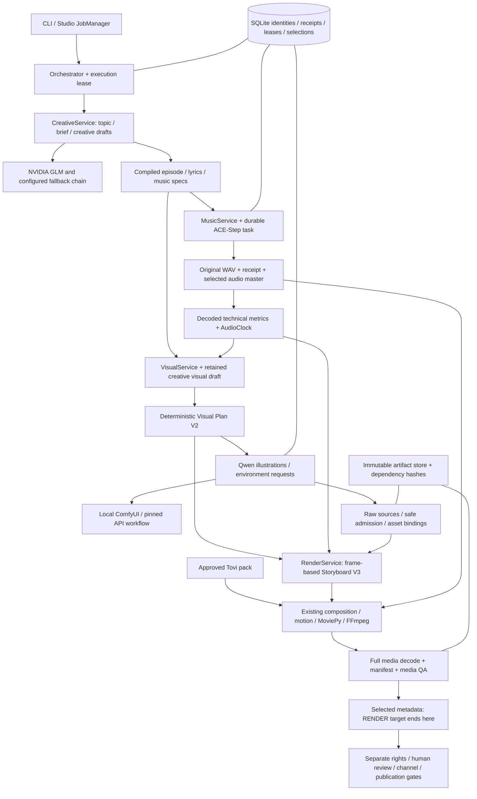

# Gate 0 architecture map

Audit base: `790da5502a966675b94a32838e303a97fb16503e` (PR #49).
This is a source audit supported by existing offline tests and read-only local
artifact checks. Earlier live reports are historical evidence, not fresh provider
validation. No subsystem is implemented or refactored here.

## Subsystem responsibilities and evidence

| Subsystem | Existing responsibility and principal entry points | Verified behavior | Limitations and dependencies |
|---|---|---|---|
| Creative direction / fallback | `creative/service.py:CreativeService.prepare`, `topics.py`, `learning.py`, `director.py:CreativeDirector`, `factory.py`, `provider.py:DurableStructuredGenerator`, `resilience.py:ResilientStructuredGenerator`, `failures.py` | Typed creative drafts, Python-owned pins, novelty memory, one structural repair, durable bounded live transient retries, sticky model choice, HTTP 410 retirement interpretation and preserved old schemas. Covered by creative, fallback, topic, retired-model and production tests. | Model availability and editorial quality are not established offline. New defaults are GLM; retained configs can still pin Kimi. Endpoint failure fails closed when optional Ollama fallback is disabled. Distinct creative fallback attempts may follow an ambiguous model outcome under existing policy; this never grants image/music resubmission. Depends on catalog, strict schemas, request ledger and execution ownership. |
| Episode planning / storyboard | `domain/creative_drafts.py`, `domain/visual_draft.py:compile_visual_draft`, `services/visual.py`, `services/render.py:_storyboard`, `domain/production_v3.py:compile_storyboard_v3` | Small model proposals compile into stable identities, source-pinned plans and contiguous 30-fps intervals covering real audio. Existing V1/V2 paths remain parsed. Historical artifacts and compiler/replay tests cover compatibility. | Thematic/educational relevance needs human review; actions outside approved capabilities fall back to supported representations with diagnostics. Environment role names are compatibility IDs, not literal biomes. Depends on approved creative sources, AudioClock, admitted art and Tovi pack. |
| ACE-Step | `music/ace_step.py:AceStepLocalProvider`, `music/benchmark.py:MusicBenchmark`, `services/music.py:_music`, `pipeline/music_adapter.py` | Existing local `/release_task`, `/query_result`, `/v1/audio` adapter preserves supplied lyrics, deterministic spec/seed, task ID before polling, immutable binding/receipt, original WAV, IEEE-float recovery and retained-task resume. ACE-Step/audio/music/recovery tests exercise mocked transports. | No stems/new voice stack. Task polling does not guarantee musical quality. A pending/uncertain existing task is queried, not released again. Separate installed ACE-Step environment and model files are prerequisites; no inference here. |
| AudioClock / timing | `pipeline/duration_source.py:admit_duration_source`, `domain/production_v3.py:AudioClock`, `music/audio.py`, `analysis.py`, `analysis_runtime.py`, `timing_runtime.py`, `services/music.py:_analysis` | Actual decoded WAV, request/master/receipt hashes, finite PCM and technical metrics establish duration. V3 needs no ASR, word alignment or lip-sync; trustworthy retained rhythm is optional. Audio and timing regression tests preserve historical analyzers. | Technical metrics do not certify intelligibility or lyrics. Historical ASR/Beat This paths are optional compatibility tools; ML extras/models are absent from ordinary CI and not provisioned here. Depends on retained music identity and source bytes. |
| Qwen / ComfyUI transport | `benchmark/providers.py:QwenComfyUIImageProvider.translate/generate/preflight`, `workflows/qwen_image_2_1_t2i_api.json` | Local workflow translation, spec-derived seed, deployed-node schema checks, remote-start callback and native task identity before polling. Mocked Qwen tests use retained ComfyUI 0.39.2 object-info fixture. | Existing workflow is text-to-image; text direction cannot guarantee cross-asset identity or semantic correctness. Required GGUF loader, text encoder, VAE and custom nodes must exist in the deployed service. A retained successful single source is not full render or cross-topic acceptance. |
| Environment / illustration admission | `render/environment_sets.py:generate_set`, `render/episode_assets.py:image_spec/generate_assets`, `render/lesson_objects.py:_prepare_qwen_white_background/normalize`, `services/visual.py:_environment`, `render/props.py` | Episode scene prompt V2 removes conflicting fixed-meadow instructions; illustration V3 is subject-scoped and fingerprints exterior-white V2 extraction. Pale contours are retained or unsuitable sources refused; deterministic cues use an explicit typed field. Selected historical art and legacy prompt/extraction versions are reused. Qwen quality, lesson-object, cue and production tests cover these contracts. | Technical PNG/alpha admission is not semantic art review. Identical backdrop/subject colors, isolated trim pixels, extra faces, inconsistent perspectives or stacked source worlds remain possible. No repainting or AI judge. Depends on frozen visual plan, provider profile, raw receipts and artifact store. |
| Durable requests / recovery | `persistence/requests.py:RequestLedger/CreativeRequestLedger`, `continuation.py:plan_continuation`, `execution.py:ProductionExecutionOwnership`, `render/image_recovery.py`, `environment_recovery.py`, `creative/recovery.py`, `visual_recovery.py`, `persistence/creative_reconciliation.py` | Prepared/start fencing, durable identities, source/provenance reuse after interrupted ingest, immutable reconciliation and one-successor grants, singleton lease/heartbeat. Native crash exception preserves the ambiguous parent; fresh evidence is rechecked before a later POST. Native crash, restart, ownership and legacy regressions cover rejection and idempotency. | Lease excludes compliant application workers, not arbitrary ComfyUI clients. GET observations and POST cannot be atomic across services. Exceptional recovery requires operator attestations and exclusive service control. Successful-source normalization must remain independent of provider generation; the historical pending source is preserved, not processed here. |
| GPU / service lifecycle | `web/supervisor.py:LocalServiceSupervisor`, `web/launcher.py`, `preflight.py`, `orchestrator.py` | Reuses healthy endpoints, tracks ownership of spawned processes, bounded startup, sanitized child environment/logging, hidden Windows processes, installed shared model mapping and owned-process shutdown. Supervisor tests use injected probes/processes. | Background startup iterates configured services independently; there is no stage-aware GPU handoff guaranteeing ACE-Step release before ComfyUI. Discovered Desktop launch adds split attention/CPU VAE but not the isolated conservative static-VRAM flags. Startup/idle health is not sampling-fit proof. Gate 1 owns this gap; no service started/stopped here. |
| Approved Tovi pack | `catalog.py`, `artifacts/character_intake.py`, `character_lock.py:validate_pack_lock`, `character_pack.py`, `render/character.py`, checked-in `brands/tovitunes/characters/tovi/packs/v1/*` | Approved revision, 48 canonical artifacts, source/active/superseded role graph, rights/approval history and reproducible hashes. Actual production and current acceptance pack PNGs decoded and matched the lock; pack/intake/replacement tests cover rehydration. | Sprite poses/mouths are finite; no articulated grasp, new rig, replacement character or mandatory lip-sync. Binary assets stay outside Git. Depends on retained source art and immutable pack/catalog pins; pack changes are out of scope. |
| Composition / motion / encoding | `render/production.py:ProductionRenderer`, `composition.py:resolve_composition`, `story.py`, `motion.py`, `character.py`, `composer.py:encode_worker`, `ffmpeg.py`, `models.py:parse_manifest` | Existing renderer builds pinned scenes, motion/character records, bounded worker encoding and final QA before selection. Normal V3 default remains `tovitunes_creative_render_v1`; r3 requires explicit visual-quality + local-preview + V3 visual-story admission and separate slots. Render, motion, composition and visual-quality tests preserve old manifests. | Renderer cannot repair incoherent raw artwork. Earlier visual comparisons include explicit preview plate overrides, which cannot be used to pass the autonomous benchmark. Source style, object scale/grounding and pose continuity still require cross-topic review. Default can change only at Gate 5 acceptance. |
| Media QA / publication | `render/qa.py:media_qa`, `services/render.py:_media_qa/_metadata`, `publication/preflight.py`, `rights_policy.py`, `service.py`, `youtube/client.py` | H.264/AAC stream, canvas, fps, duration/aspect and full audio/video decode checks; hash/dependency-bound QA/metadata. RENDER stops before RELEASE/YOUTUBE. Separate rights/human/channel/private-upload/public-promotion gates, durable ambiguous upload handling and same-video identity remain covered by release/YouTube tests. | Technical success is insufficient for editorial release. Real production config has publication capability enabled, but no upload/publish intent is exercised. Existing rights decisions are preserved, not newly certified. |
| Studio / production progress | `web/app.py`, `studio.py:studio_router/library`, `jobs.py:JobManager`, `services.py:system_status`, `diagnostics.py:studio_job`, `progress.py`, `run_history.py`, `web/static/*` | Saved target and run/episode reference, retained milestones, recovery blocks, local media links independent of publication, readiness vs generation distinction, coalesced library refresh and resumed-job visibility. Existing Python and Node frontend tests exercise these states. | Readiness reports presence/reachability, not completed generation or editorial acceptance. No live Studio session or production launch is used for Gate 0. Shared orchestrator and ledger remain execution authority. |
| Compatibility / regression framework | `tests/`, `tests/fixtures/`, `.github/workflows/ci.yml`, `uv.lock` | Full offline suite uses fake/mock providers plus real local FFmpeg. Exact-head hosted workflow checks the requested SHA, lock, Ruff, strict Mypy, character pack and native crash/full regressions. Disposable copies also test migration replay and actual stored formats. | Offline fixtures do not establish current NVIDIA availability, GPU peak fit or new art/audio quality. No fixtures rewritten, tests disabled or new test-count workstream added. |

## Overlap retained deliberately

- `pipeline/creative.py` and `creative/service.py` serve reviewed draft operations
  and autonomous run lifecycle respectively; `CreativeDirector` connects them.
- `pipeline/production.py` / historical timed storyboards / `music/analysis.py`
  coexist with duration-source AudioClock / Storyboard V3. Preserve both validators.
- `benchmark/providers.py` and `music/benchmark.py` are used by production as well
  as explicit benchmark tools. They are not disposable duplicate frameworks.
- `render/lesson_objects.py` handles historically reviewed object candidates;
  `episode_assets.py` handles plan-bound episode illustrations and reuses its
  extraction primitives. `environment_requests` has a separate durable table
  from illustration `generation_requests`; do not collapse their identities.
- `render/composition.py` plans spatial layout, `composer.py` renders frames, and
  `production.py` owns artifact/manifest admission. Similar names do not imply
  interchangeable responsibilities.
- Normal, historical visual-story/dynamic and r1/r2/r3 preview manifests coexist.
  New prompt versions and deterministic cues preserve historical provider schemas.
- `publication/*` owns review/rights/release intent; `youtube/client.py` owns
  transport. Studio projections and continuation planning are views over durable
  evidence, not alternative execution authorities.

No removal or consolidation is authorized by this inventory. Relevant limitations
map only to Gates 1–5 in [OWNERSHIP.md](OWNERSHIP.md).
